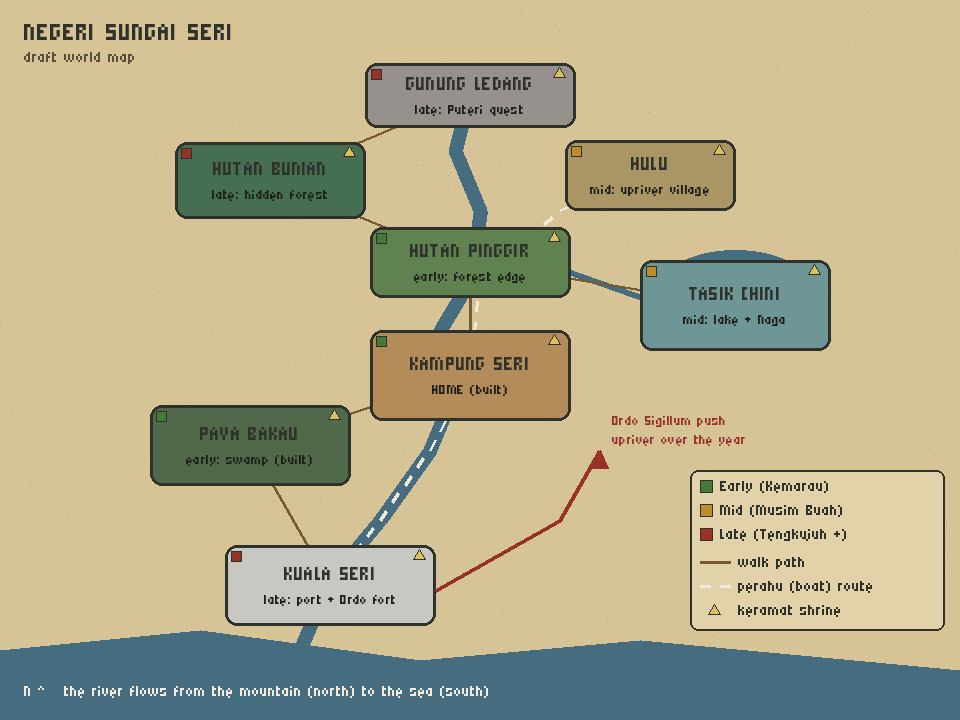

# Game design notes

> **Status key:** ✅ Approved · 💡 Suggestion (pending approval)
>
> To approve a suggestion, move it into the **Approved** section and note who
> approved it. Reject by moving it to "Rejected ideas".

---

## ✅ Approved

### Theme & era
- **Setting:** Old Malaysia / Nusantara, **around the 15th century**: the era
  of the Melaka Sultanate, Hang Tuah and the Puteri Gunung Ledang legend.
- **Fantasy layer:** Malay folklore and legends: Naga Tasik Chini, Bujang
  Senang, Orang Bunian, Puteri Gunung Ledang.
- **Art style:** Similar to / inspired by **Stoneshard**.
- Keep things era-appropriate: no rifles, rubber, cassava or other later items.

### Tone
- **Dark but hopeful.** The cruelty is real, but the story is about the village
  rising back up. Cozy farm moments give relief between the dark parts.

### World & zones *(prototype)*
- **Connected zones** (walk off an edge into the next zone). Built so far:
  - **Kampung**, the main place and the player's home (48 px tiles, PixelLab tilesets in the swamp
    style): dirt yard with 4 rumah kampung (2x scale), sawah fields where padi is planted, sandy
    riverbank with a jetty, river. West path → swamp; **north path → Hutan Pinggir** (not built
    yet: "the forest is not safe yet").
  - **Houses:** yours, **Mak Som**, **Pak Hamid** and **Tok Pawang** (the mossy one, with a small,
    easy-to-miss sign and a pelita post). Pressing E at a neighbour's door gives a short line.
  - **Details:** rail fences on the sawah bunds (path between the two fields), firewood, tempayan,
    stones and reeds at the jetty. Small props are drawn at 1×, matching the Pendekar's pixel size.
  - **Paya Bakau, the mangrove swamp** (48 px tiles, Dark Swamp pack): river with boardwalks and an
    island with a **defiled keramat**. Future home of Bujang Senang.
- The early placeholder farm zone was removed; farming now happens in the kampung sawah.
- Planted padi persists across zones; passing out anywhere wakes you at home in the kampung.
- Time: 25 real minutes = 24 in-game hours (a 06:00-02:00 day is about 21 real minutes). Shift = run.
- **Calendar:** 3 monsoon seasons x 28 days (Kemarau, Musim Buah, Tengkujuh), Malay weekdays
  (Isnin...Ahad). Currency: **pitis** (tin coins of the Melaka era). Clock UI top-right.
- **Weather:** rolled each morning by season (rain chance: Kemarau 6%, Musim Buah 25%,
  Tengkujuh 65%). Rain darkens the light and strengthens the wind; clear Kemarau days have a
  warm haze.
- **Ambience (all zones):** wind sway, water glints, cloud shadows, birds, falling leaves, dust
  motes, pelita lamps and fireflies at night (`scripts/world/ambience.gd`).

### Team roles
- **leoxent**: sprites / character art.

### Multiplayer
- **Solo, with an optional co-op mode.**
- Tech note: build with co-op in mind from the start (Godot multiplayer), even
  if it ships later. Adding it at the end is very painful.

### Main villain: the Penjajah = **Ordo Sigillum** ("Order of the Seal")
- A **fictional empire**, inspired by real colonisers but invented.
- Locals may call them *Orang Putih Tulang* or just "si Penjajah".
- **Look:**
  - **Colours:** bone-white and iron-grey with a **black seal sigil**.
  - **Soldiers:** white tabards over brigandine, open-faced helmets, pikes and
    crossbows. Elite troops carry hand cannons.
  - **Binders (occult officers):** grey robes, wax-sealed scrolls, iron
    **spirit-lanterns** with trapped spirits glowing inside, chained books.
  - **Bound spirits:** marked with the black seal and wrapped in iron chains or
    nails, so the player can tell them from free spirits.
  - **Buildings:** square stone forts with bone-white banners; carracks with pale sails.
- **Emblem & ranks** *(was S16)*: an **eye in the centre of a round seal,
  pinned by radiating iron nails, with wings**. The emblem's metal and detail
  show rank:

  | Rank | Emblem |
  |---|---|
  | **Acolyte** | Grey iron seal, dark grey wings, plain. |
  | **Warden** | Bronze/copper seal, pale gold wings. |
  | **Grandmaster** | Gold and red seal set with jewels, large ornate red-gold wings. |

  Concept art: `docs/references/concept/emblems-ordo-sigillum-ranks.jpg`.
- **Occult empire with 15th-century military equipment.** They came here *for*
  the spirits. Spirit-binding is their real source of power, backed by an army
  of the period:
  - pikes, halberds, swords, crossbows
  - early gunpowder: hand cannons, early matchlock arquebuses, bombards
  - brigandine and plate armour, helmets
  - stone forts and warships (carrack-style)
- They **capture or bind local spirits** and use them as underlings:
  *pelesit / polong*, *toyol*, *hantu raya*, *pontianak*, *penanggal*,
  *harimau jadian*.
- **Freeing bound spirits** is a core goal; freed spirits can become allies.

### Legends as major characters
- **Naga Tasik Chini**: guardian of the lake; the Penjajah want to drain it for mining.
- **Bujang Senang**: giant river crocodile; a neutral force, dangerous but not evil.
- **Orang Bunian**: hidden forest village; trade, side quests, a "hidden world" area.
- **Puteri Gunung Ledang**: her impossible demands become a late-game quest chain.

### Farming
- **Crops (era-appropriate):** padi (sawah), kelapa, pisang, keladi (taro),
  ubi (yam), sagu, sireh, lada, tebu, durian, rambutan, manggis.
- **Monsoon seasons** instead of 4 seasons: Musim Tengkujuh (floods),
  Musim Kemarau (dry), Musim Buah (fruit).
- **Livestock:** ayam kampung, itik, kambing, kerbau (ploughing the sawah).
- **Buildings:** rumah kampung on stilts, jelapang padi, perahu for river travel.

### Core conflict loop: a cruel Penjajah
The Penjajah are **openly cruel**, not just strict:
- Heavy **harvest taxes**. Failing to pay means punishment: burned crops,
  confiscated livestock, villagers taken away.
- **Land seizure** and **forced labour** in their tin mines, pepper estates and forts.
- **Public punishments** and raids on the kampung to spread fear.
- Using bound spirits to **terrorise** villages at night.
- The player decides: comply, resist quietly, or fight openly, **with real
  consequences** for the village (villagers can be hurt, leave, or join the
  resistance).

### Player character: the old pawang's questions
- At the start, an **old pawang asks the player questions**, **7 at most**
  (exact number TBD).
- **Class questions** decide the player's **class**.
- **Personality questions** decide the player's **blessing**: **one permanent,
  upgradeable skill** (active or passive).

### Classes *(tentative, was S13)*

| Class | Local name | Style |
|---|---|---|
| Warrior | **Hulubalang** | Heavy armour, tombak & shield. Tanky frontline. |
| Fighter | **Pendekar** | Silat master, keris or bare hands. Fast combos, counters. |
| Assassin | **Bayang** ("shadow") | Stealth, poisoned keris, sumpit (blowpipe), backstabs. |
| Mage | **Pawang** | Spirit magic, charms, can talk to and command freed spirits. |

Example class questions from the old pawang:
1. *"Soldiers are burning your neighbour's house. What do you do?"*
   → Stand in front of them (Hulubalang) / Fight them head-on (Pendekar) /
   Wait and strike at night (Bayang) / Call on the spirits (Pawang)
2. *"What do you trust most?"* → Strength / Skill / Silence / The unseen world
3. *"Which weapon did your father leave you?"* → Tombak / Keris / Sumpit / Azimat

### Blessings *(approved as a starting list, details TBD, was S14)*
One blessing per playthrough. It is **permanent** and **upgraded** through
offerings at shrines and spirit quests (e.g. levels 1–5). Any class can get any blessing.

| Personality | Blessing | Type | Effect | Upgrade path |
|---|---|---|---|---|
| Brave | **Sisik Naga** (Dragon Scale), from Naga Tasik Chini | Passive | Once per day, survive a killing blow with 1 HP. | More uses per day → heal on trigger → shockwave that knocks enemies back. |
| Nurturing | **Semangat Padi** (Rice Spirit) | Passive | Crops grow faster and better; slow healing on your own farmland. | Wider area → chance of double harvest → crops survive floods and drought. |
| Curious / sly | **Langkah Bunian** (Bunian Step) | Active | Briefly step into the hidden world: invisible, pass through enemies. | Longer duration → see hidden paths/items → bonus damage on the first attack out of it. |
| Fierce | **Gigit Bujang Senang** (Crocodile Bite) | Active | Lunge and lock onto one enemy, stunning it. | Longer stun → "death roll" damage → works on large enemies and spirits. |
| Wise | **Mata Batin** (Inner Eye) | Passive | See spirits, bound seals, and enemy weak points. | Bonus damage vs spirits → break seals faster → reveal enemies through walls. |
| Loyal / protective | **Panggilan Tok Belang** (Call of the Tiger Spirit) | Active | Summon a spirit tiger that fights beside you for a short time. | Longer summon → tiger guards the farm at night → tiger can be ridden. |
| Patient / calm | **Bayu Ledang** (Ledang Wind) | Active | Slow time around you for a few seconds. | Longer duration → full speed inside it → enemies inside take damage. |
| Charismatic | **Lidah Bertuah** (Blessed Tongue) | Passive | Better prices, faster villager trust, weak enemies may flee. | Easier recruiting → turn bound spirits without fighting → soldiers may defect. |

Story hook: the Ordo Sigillum want to capture the player *because* of their blessing.

### Magic & weapons
- **Pawang / bomoh** magic: charms (azimat), spirit offerings, protecting crops.
- Era weapons: keris, parang, tombak, golok, sumpit.
- **Combat style: real-time action** *(was S15)*. Move and attack freely, with
  dodges and combos (top-down action RPG). Silat flavours the movement,
  combos and counters.
  - Works well with real-time farming and co-op.
  - Needs more animation frames per class, so plan the art budget around it.

### Player-side emblems *(was S17)*
| Faction | Emblem |
|---|---|
| **Resistance** | A keris crossed over a padi stalk on a riveted iron plate. |
| **Naga Tasik Chini** | A naga coiled inside a round teal-and-copper frame, above lake water. |
| **Orang Bunian** | A pale green leaf with gold veins on a silver frame, faintly glowing. |

Concept art: `docs/references/concept/emblems-player-factions.jpg`.

Polish notes for the final versions:
- The **keris** in the concept has a straight blade and a pistol-grip hilt.
  A real keris has an asymmetric guard (*ganja*) and often a wavy blade
  (*luk*); use museum references.
- The **naga** in the concept looks like a European dragon. A Malay naga is
  more serpent-like, often wears a crown (*mahkota*) and has no legs.

### Art direction
- Top-down ¾ view, muted earthy palette with bright accents (padi gold,
  hibiscus red, spirit glows).
- Visible equipment on the character (layered sprites).
- Strong night/torch lighting to suit the folklore horror side.
- Designs based on real references: museum keris, songket, rumah Melayu, old manuscripts.
- Inspiration only: no copying Stoneshard assets, palette or UI.

### ⭐ Official sprite format
**Reference sheet:** `docs/references/concept/official-sprite-format-ordo-sigillum.jpg`
(Ordo Sigillum soldiers, Binders and bound spirits). All new character and
creature sprites must match it.

| Rule | Value |
|---|---|
| Tile size | **32×32 px** |
| Base resolution | **640×360**, integer scaling (project already set) |
| Character size | about **24×36–40 px** (≈ 1 tile wide, ≈ 1¼ tiles tall); bigger creatures and bosses can be larger |
| View | top-down ¾ |
| Directions | **4 directions**: front (down), back (up), side (right). **Left = side flipped**, so draw 3 views |
| Colours | limited palette, roughly 16–24 colours per sprite, simple shading |
| Outline | dark outline (not pure black) |
| Shadow | soft dark oval drop shadow under every character; can be a separate sprite |
| Glow / light | lanterns, spirits and magic glow via Godot `PointLight2D` / additive effects, **not baked into the sprite** |
| File format | **PNG** with transparency, exact pixel grid. No JPG for game assets |
| Anchor | sprite origin at the feet (bottom centre) |

Notes:
- The reference sheet is a JPG concept and not pixel-perfect. Use it for size,
  proportions, style and colours; final sprites must be clean PNGs.
- Minimum animation set per character (to confirm later): idle, walk, attack,
  hurt, death, plus farming actions for the player (hoe, water, harvest).

---

## 💡 Suggestions (pending approval)

### S25. World map design *(replaces S18–S23)*

**1. Structure:** connected zones (walk off an edge into the next zone), as now. Each zone is
its own Godot scene, so friends can build zones in parallel without conflicts. All zones use
**48 px tiles** (one screen ≈ 13×7.5 tiles).

**2. The region: Negeri Sungai Seri** (placeholder name). One river runs from **Gunung Ledang**
(north) down to the **sea** (south). The river is the backbone: story path, travel route
(perahu) and the way the Ordo Sigillum advance (they land at the river mouth and push upriver).
The legends come from different real places, so this invented negeri brings them together.

**3. Zones**

| Zone | Role | Stage | Size (tiles) | Status |
|---|---|---|---|---|
| **Kampung Seri** | Home hub: your house, neighbours, sawah, jetty, shops | Early | 46×32 | ✅ built |
| **Paya Bakau** | Mangrove swamp: defiled keramat, fishing, Bujang Senang's river | Early | 32×22 | ✅ built |
| **Hutan Pinggir** | Forest edge north of the kampung: foraging, wood and rattan, first free spirits, first Ordo patrol | Early | ~50×40 | next |
| **Tasik Chini** | Lotus lake east of the forest: Naga Tasik Chini, Ordo mining camp draining the lake | Mid | ~50×40 | later |
| **Hulu** | Upriver village by perahu: second kampung, trader, rare seeds | Mid | ~40×30 | later |
| **Hutan Bunian** | Highland forest with a **hidden version** (Orang Bunian village) | Late | ~50×50 | later |
| **Kuala Seri** | River-mouth port held by the Ordo: stone fort, docks, occupied market | Late | ~60×40 | later |
| **Gunung Ledang** | Mountain: Puteri Gunung Ledang's quest chain, final areas | Late | ~40×60 | later |

**4. Connections**
- **Walking:** Kampung ↔ Paya Bakau (west, built) · Kampung ↔ Hutan Pinggir (north) ·
  Hutan Pinggir ↔ Tasik Chini (east) · Hutan Pinggir ↔ Hutan Bunian (north-west) ·
  Hutan Bunian ↔ Gunung Ledang · Paya Bakau ↔ Kuala Seri (south).
- **Perahu (boat):** jetties at Kuala Seri, Kampung Seri and Hulu. Travel by boat between them
  once the perahu is repaired. It doubles as the main fast travel.
- **Keramat shrines:** one per zone. Cleanse it once to unlock fast travel to it and blessing
  upgrades there.

**5. Progression across the seasons** (year 1)
- **Kemarau (early):** Kampung, Paya Bakau, Hutan Pinggir. Learn farming, meet the old
  pawang, first spirits, first Ordo tax visit.
- **Musim Buah (mid):** repair the perahu → **Hulu**; clear the overgrown trail (parang) →
  **Tasik Chini** and the Naga.
- **Tengkujuh (late):** floods close low swamp paths but open **new water routes** by perahu,
  including into **Kuala Seri**. **Hutan Bunian** is seen with Mata Batin, at dusk, or after the
  Bunian trust you. **Gunung Ledang** opens after freeing 3 bound legends.

**6. What makes the map feel alive** (systems that change zones)
- **Ordo control (0–3) per zone:** more banners, checkpoints, patrols, burnt or seized sawah
  and darker colours as control rises; cleansing the keramat and freeing spirits push it back.
- **Monsoon:** Tengkujuh floods low ground (sawah and swamp paths) and raises the river;
  Kemarau lowers it and exposes **sandbar shortcuts**.
- **Day/night:** more spirits and Ordo raids at night; Bunian paths appear at dusk.

**7. Kampung Seri: planned points of interest** (fills the built hub)
- Your rumah kampung (sleep, later storage) · **Tok Pawang's house** (the opening questions)
- **Surau** · **Balai** (village hall + notice board for tax days and requests)
- **Gerai / pasar** (stall: sell padi, buy seeds) · **Perigi** (well) · **Jelapang padi** (rice barn)
- **Jetty + perahu** (boat travel, fishing) · **Pondok cukai** (Ordo tax post at the kampung edge)
- Exits: west → Paya Bakau (built), **north → Hutan Pinggir** (new path).

**8. Suggested build order**
1. Kampung points of interest (stall, pawang's house, well) using existing assets plus a few new sprites.
2. **Hutan Pinggir** zone + the kampung's north exit.
3. Perahu travel between jetties (start with Kampung ↔ Paya Bakau as a test).
4. Ordo control visuals in the kampung (tax post, banners) to show the conflict early.

**Co-op note:** both players stay in the same zone for now; splitting up can come later.

### S24. Player customisation: character creator + visible equipment
Players can **change their look at the start** (character creator) **and during
the game** (clothes, armour, headgear and weapons show on the sprite). Both
**male and female** player characters.

Drawing every item as a fully animated layer is too much work: 20 items × 8
animations × 3 directions ≈ 480 animations. So each slot is handled in the
cheapest way that still looks right:

| Slot | How | Animation cost |
|---|---|---|
| **Body + outfit** (Hulubalang, Pendekar, Bayang, Pawang) | One full sprite per outfit, skin included. Keep the number of outfits small. | High: 8 animations × 3 directions per outfit |
| **Skin, cloth and hair colours** | **Palette swap** shader in Godot | Almost free |
| **Headgear** (tengkolok, ketopong, selendang, kelubung, bayang mask) | Static layer, 3 directions, pinned to a **head anchor** per frame | Low: 3 images per item |
| **Weapons** (keris, tombak, sumpit, perisai) | Static layer, pinned and rotated on a **hand anchor** per frame | Low: 1–3 images per item |

**Character creator** (start of game): body type (male/female), skin tone, hair
style and colour, cloth colours. At ~40 px the face is only a few pixels, so
"face options" are limited to eye/brow colour, not face shape.

**Equipment** (during the game): outfits swap the body sprite; headgear and
weapons swap layers; colour variants make one shape feel like several items
(e.g. red, indigo and black tengkolok from one sprite).

**Male and female**
- Same skeleton, height and anchor points, so every headgear, weapon and palette
  works on both. Only body shape, hair and clothing differ.
- Body + outfit sprites double: 4 class outfits × 2 = **8 bodies,
  ~192 animations** for the player.
- **Petani (farmer) is not a player outfit.** Farmers are **NPCs** the player can
  talk to and interact with, not playable characters (decided by leoxent,
  2026-11-20). Their sprites come from the NPC budget, not the player set.
- Each headgear item is tagged *male / female / both* (e.g. tengkolok = male,
  selendang = female, ketopong = both).
- **Head covering for women (kelubung)** is a **headgear layer, not part of the
  body sprite** (decided by leoxent, 2026-11-20). The player chooses to wear it
  or not, and it works on every class without new bodies.
  - Style: a long plain draped head cloth over hair, neck and shoulders, as in
    15th-century Melaka. **Not** a modern tudung (bawal, sarung or awning styles).
  - Tagged *female*. It hides the hair completely, so female base sprites keep
    their hair in a **tight, compact bun** that fits under the layer.
  - Static layer (3 images), so it does not sway in animations. This is
    acceptable at ~40 px.
- Women are real fighters: practical, era-appropriate clothing (baju panjang,
  kain sarung, selendang; baju rantai for Hulubalang), never revealing.

**Rules this adds for sprites**
- All outfits for one body type use the **same skeleton/poses**, so frames line
  up and anchors stay valid.
- Every body sprite uses **one fixed master palette** (skin, cloth, hair ramps
  on known indices) so the palette-swap shader works.
- Each animation frame stores its **head and hand anchor points** in a small
  data file next to the sheet.

**Tooling: PixelLab** (see `docs/references/pixellab/README.md`)
- Gemini and SpriteCook tests drew characters large and lost detail when shrunk
  to ~40 px. PixelLab works at real pixel size, rotates to 4 directions and has
  skeleton-based animation.
- Estimate: ~2–4 generations per animation with retries → **~500–1,000
  generations** for the player set. Tier 1 ($12/month, 2,000 generations) covers
  it in about a month.

**Test before approving** (fits in PixelLab's 40 free generations):
1. Male and female base → rotate to 4 directions. Same look in every direction?
2. Run (down) at ~40 px. Readable at real size?
3. Change outfit with inpainting (e.g. farmer → Hulubalang). Body and face kept?
4. Animate the new outfit with the **same skeleton**. Do frames line up with the base?

If step 4 fails, fall back to fewer outfits plus more palette variants.

Test run 2026-11-20 (17 generations): all four steps passed, with notes. The
test used farmer bodies as stand-in bases, so those sprites are NPC material, not
player art. Results: `assets/sprites/player/s24_test/README.md`.

## Open questions
- Final game name?
- Exact number of pawang questions (max 7)?
- Final blessing list and balancing?
- How many outfits per body type at launch (S24)?

## Superseded suggestions
- S18–S23 (world structure, region, starting zones, zone size, map features, co-op on the
  map): merged and updated into **S25**. They assumed a separate farm zone and 32 px tiles.

## Rejected ideas
- Real-history Penjajah (Portuguese / British / Japanese) → replaced by a fictional empire.
- Modern weapons (rifles, modern army) → replaced by 15th-century equipment.
